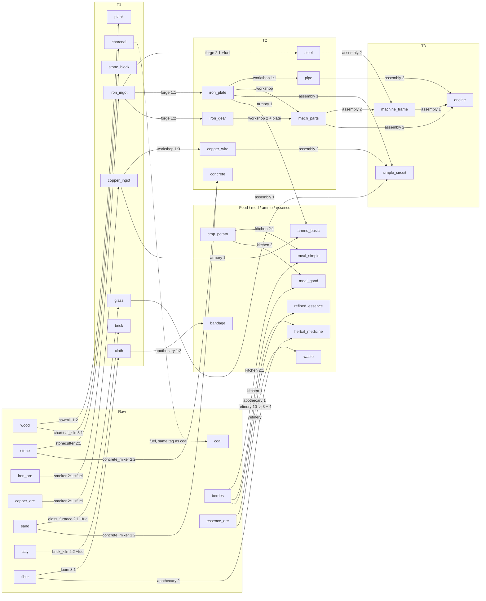

# Resources and production chains (E10-E17 master table)

Status: draft v1, all numbers are starting points for balancing. Existing ids in `data/items.json` / `data/recipes.json` are kept as-is: `essence_ore`, `refined_essence`, `waste` (NOT renamed to essence_refined / toxic_waste). Existing recipe `refine_essence` (10 essence_ore -> 3 refined_essence + 4 waste, 100 ticks) is unchanged.

Format note: current `items.json` entries are `{name, color, stack, [contaminates]}`; recipes are `{name, inputs{}, outputs{}, work_ticks}`. The columns `tier`, `category`, `weight`, `tags` below are proposed new fields; `building` and `skill` are proposed new recipe fields. Skill ids are proposals (no skill system data exists yet).

## 1. Items

Weight is in arbitrary units (carry-capacity balancing). Stack = max per cell stack.

| id | Name (RU) | tier | category | weight | stack | tags | source |
|---|---|---|---|---|---|---|---|
| wood | Древесина | raw | material | 1.0 | 100 | fuel_raw, flammable | trees (chop) |
| stone | Камень | raw | material | 2.0 | 100 | | stone tiles (mine) |
| iron_ore | Железная руда | raw | ore | 2.0 | 75 | ore | iron deposits (mine) |
| copper_ore | Медная руда | raw | ore | 2.0 | 75 | ore | copper deposits (mine) |
| coal | Уголь | raw | fuel | 1.0 | 100 | fuel | coal deposits (mine) |
| sand | Песок | raw | material | 1.5 | 100 | | sand tiles (mine/dig) |
| clay | Глина | raw | material | 1.5 | 100 | | clay tiles (mine/dig) |
| fiber | Волокно | raw | material | 0.3 | 100 | flammable | bushes / fiber plants (harvest) |
| berries | Ягоды | raw | food_raw | 0.2 | 75 | food, perishable | berry bushes (harvest) |
| essence_ore | Руда эссенции | raw | essence | 2.0 | 50 | contaminating_chain | essence deposits (mine) - EXISTING |
| plank | Доска | T1 | material | 0.8 | 100 | construction | sawmill |
| stone_block | Каменный блок | T1 | material | 3.0 | 75 | construction | stonecutter |
| iron_ingot | Железный слиток | T1 | metal | 1.5 | 75 | metal | smelter |
| copper_ingot | Медный слиток | T1 | metal | 1.5 | 75 | metal | smelter |
| charcoal | Древесный уголь | T1 | fuel | 0.7 | 100 | fuel | charcoal_kiln |
| glass | Стекло | T1 | material | 1.0 | 75 | fragile | glass_furnace |
| brick | Кирпич | T1 | material | 2.0 | 75 | construction | brick_kiln |
| cloth | Ткань | T1 | material | 0.4 | 100 | flammable | loom |
| steel | Сталь | T2 | metal | 2.0 | 50 | metal | forge |
| iron_plate | Железная пластина | T2 | part | 1.2 | 75 | metal | forge |
| iron_gear | Шестерня | T2 | part | 0.6 | 75 | metal | forge |
| copper_wire | Медный провод | T2 | part | 0.2 | 100 | metal | workshop |
| pipe | Труба | T2 | part | 1.0 | 75 | metal | workshop |
| mech_parts | Мехдетали | T2 | part | 1.5 | 50 | | workshop |
| concrete | Бетон | T2 | material | 3.0 | 75 | construction | concrete_mixer |
| machine_frame | Станина | T3 | component | 5.0 | 25 | | assembly |
| engine | Двигатель | T3 | component | 6.0 | 20 | | assembly |
| simple_circuit | Простая схема | T3 | component | 0.3 | 50 | fragile | assembly |
| crop_potato | Картофель | food | food_raw | 0.3 | 75 | food, perishable | farm zone (grown) |
| meal_simple | Простая еда | food | meal | 0.4 | 50 | food, meal, perishable | kitchen |
| meal_good | Хорошая еда | food | meal | 0.4 | 50 | food, meal, perishable, mood+ | kitchen |
| herbal_medicine | Травяное лекарство | med | medicine | 0.3 | 50 | medicine | apothecary |
| bandage | Бинт | med | medicine | 0.1 | 100 | medicine | apothecary |
| ammo_basic | Патроны | ammo | ammo | 0.05 | 200 | ammo | armory |
| refined_essence | Очищенная эссенция | essence | essence | 1.0 | 50 | currency_of_escape | refinery (`refine_essence`) - EXISTING |
| waste | Отходы | essence | waste | 2.0 | 50 | contaminates | refinery by-product - EXISTING |

`charcoal` carries tag `fuel`, same as `coal`: every recipe that consumes coal must accept any item with tag `fuel` (coal or charcoal). Charcoal costs 3 wood per unit (150 ticks) so coal stays strictly better where deposits exist.

## 2. Recipes

Starting numbers (fixed by the design brief). `ticks` = `work_ticks`. Skill ids are proposed.

| building | inputs | outputs | ticks | skill |
|---|---|---|---|---|
| sawmill | 1 wood | 2 plank | 60 | crafting |
| stonecutter | 2 stone | 1 stone_block | 80 | crafting |
| smelter | 2 iron_ore + 1 coal(fuel) | 1 iron_ingot | 120 | smithing |
| smelter | 2 copper_ore + 1 coal(fuel) | 1 copper_ingot | 120 | smithing |
| charcoal_kiln | 3 wood | 1 charcoal | 150 | crafting |
| glass_furnace | 2 sand + 1 coal(fuel) | 1 glass | 100 | smithing |
| brick_kiln | 2 clay + 1 coal(fuel) | 2 brick | 100 | crafting |
| loom | 3 fiber | 1 cloth | 90 | crafting |
| forge | 2 iron_ingot + 1 coal(fuel) | 1 steel | 180 | smithing |
| forge | 1 iron_ingot | 1 iron_plate | 60 | smithing |
| forge | 1 iron_ingot | 2 iron_gear | 80 | smithing |
| workshop | 1 copper_ingot | 3 copper_wire | 60 | crafting |
| workshop | 1 iron_plate | 1 pipe | 70 | crafting |
| workshop | 2 iron_gear + 1 iron_plate | 1 mech_parts | 120 | crafting |
| concrete_mixer | 2 stone + 1 sand | 2 concrete | 90 | construction |
| assembly | 2 steel + 2 mech_parts | 1 machine_frame | 240 | engineering |
| assembly | 1 machine_frame + 2 pipe + 2 mech_parts | 1 engine | 300 | engineering |
| assembly | 2 copper_wire + 1 glass + 1 iron_plate | 1 simple_circuit | 200 | engineering |
| kitchen | 2 berries | 1 meal_simple | 60 | cooking |
| kitchen | 2 crop_potato | 1 meal_simple | 60 | cooking |
| kitchen | 2 crop_potato + 1 berries | 1 meal_good | 100 | cooking |
| apothecary | 2 fiber + 1 berries | 1 herbal_medicine | 90 | medicine |
| apothecary | 1 cloth | 2 bandage | 40 | medicine |
| armory | 1 iron_plate + 1 copper_ingot + 1 coal(fuel) | 10 ammo_basic | 80 | smithing |

## 3. Building costs (proposed starting points)

Rule of thumb: tier-0 buildings cost raw/T1 only; each tier gates the next (smelter needs bricks, assembly needs steel + concrete).

| building | cost | note |
|---|---|---|
| sawmill | 20 wood + 10 stone | given |
| smelter | 30 stone_block + 10 brick | given |
| assembly | 20 steel + 10 mech_parts + 20 concrete | given |
| stonecutter | 30 wood + 10 stone | |
| charcoal_kiln | 20 stone_block + 10 plank | |
| glass_furnace | 20 stone_block + 10 brick | |
| brick_kiln | 20 stone + 10 plank | |
| loom | 20 plank + 10 fiber | |
| forge | 20 stone_block + 10 brick + 10 iron_ingot | |
| workshop | 30 plank + 10 iron_plate | |
| concrete_mixer | 20 stone_block + 10 iron_plate | |
| kitchen | 20 plank + 10 stone_block | |
| apothecary | 20 plank + 10 cloth | |
| armory | 20 plank + 20 iron_plate + 5 mech_parts | |
| research_table | 20 plank + 5 iron_plate + 5 glass | |
| steam_generator | 20 steel + 10 pipe + 10 brick | burns fuel (coal/charcoal) |
| power_pole | 2 plank + 1 copper_wire | |
| conveyor | 1 iron_plate (per tile) | |
| inserter | 2 iron_plate + 1 iron_gear + 1 copper_wire | |
| heavy_turret | 10 steel + 5 mech_parts + 5 concrete | |
| wall | 2 stone_block (stone_block tier) / 1 concrete (upgrade) | |
| door | 4 plank + 1 iron_plate | |
| floor | 1 plank (wood) / 1 stone_block (stone) | |
| bed | 5 plank + 3 cloth | |

## 4. Dependency graph

Items are nodes; edge label = building (and ratio where it matters). Fuel edges from coal/charcoal into smelter/forge/glass/brick/armory are collapsed into the note below the graph to keep it readable.

Fuel (`coal` or `charcoal`, 1 each) is also consumed by: smelter (both recipes), glass_furnace, brick_kiln, forge (steel only), armory.

## 5. Raw cost roll-up (coal counted as coal; charcoal substitute = 3 wood per coal)

Per-unit raw cost of intermediates (fractional where a recipe yields several):

| item | iron_ore | copper_ore | coal | sand | notes |
|---|---|---|---|---|---|
| iron_ingot | 2 | | 1 | | |
| copper_ingot | | 2 | 1 | | |
| steel | 4 | | 3 | | 2 ingot + 1 coal |
| iron_plate / pipe | 2 | | 1 | | |
| iron_gear | 1 | | 0.5 | | 2 per ingot |
| copper_wire | | 0.67 | 0.33 | | 3 per ingot |
| mech_parts | 4 | | 2 | | 2 gear + 1 plate = 2 ingot |
| glass | | | 1 | 2 | |
| concrete | | | | 0.5 | plus 1 stone each |

Targets:

| target | iron_ore | copper_ore | coal | sand | derivation |
|---|---|---|---|---|---|
| machine_frame | 16 | 0 | 10 | 0 | 2 steel (8 ore, 6 coal) + 2 mech_parts (8 ore, 4 coal) |
| engine | 28 | 0 | 16 | 0 | frame (16, 10) + 2 pipe (4, 2) + 2 mech_parts (8, 4) |
| simple_circuit | 2 | 1.33 | 2.67 | 2 | 2 wire (1.33 cu, 0.67 coal) + glass (1 coal, 2 sand) + plate (2 fe, 1 coal) |
| 10 ammo_basic | 2 | 2 | 3 | 0 | 1 plate (2 fe, 1 coal) + 1 cu ingot (2 cu, 1 coal) + 1 coal |

Takeaway: coal is the universal bottleneck (an engine eats 16 coal across its smelting steps), while iron ore dominates raw mining volume for T3 (28 ore per engine).

## 6. Open balance questions (for the orchestrator)

1. Coal supply: engine = 28 ore + 16 coal. Should coal deposits be common (similar to iron) or scarce so charcoal (3 wood/coal) becomes the standard fuel? Decide deposit density in mapgen.
2. Do we need a fuel-burn rule for buildings (power/steam) in the same item pool, or is fuel only a recipe input? Affects whether `steam_generator` competes with smelters for coal.
3. Is `tier` gating by research (research_table) or only by building prerequisites? Costs in section 3 assume building-chain gating only.
4. Weights/carry capacity: colonists currently have no carry limit in `ItemSystem`? If none, `weight` is cosmetic until hauling capacity exists.
5. Perishable food: tag `perishable` implies a decay system that does not exist. Defer, or drop the tag until stress/needs are in scope (CLAUDE.md: stress is out of scope).
6. Ammo: 10 ammo per 80 ticks and 3 raw-ish inputs. Check against balance_report wave sizes: how many rounds per wave per turret?
7. Stack sizes vs the "one stack per cell" rule: stack 20-25 for T3 means a stockpile cell holds few units; confirm storage zones are big enough, or raise stacks.
8. Skills: introduce crafting/smithing/engineering/cooking/medicine/construction as new skills, or map onto the existing colonist skill set (check `data/` before E10)?
9. Where do refined_essence / waste sit in this web? Proposal: refining stays independent of the metal chain (waste is the only contaminating output), and refined_essence is spent on late buildings/escape goals, not on T1-T3 recipes. Confirm.
10. Single-output-per-recipe-per-building: several buildings (smelter, forge, workshop, assembly, kitchen, apothecary) hold multiple recipes. The recipe picker / per-building active recipe needs a UI and `BuildingSystem` change.
